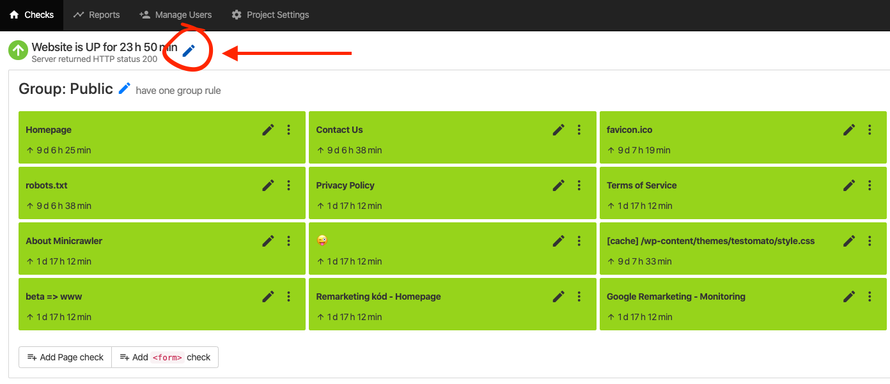
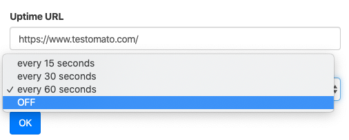

Uptime monitoring checks whether your site or server is reachable and measures its response time. It is automatically enabled on the **Professional**, **Business**, and **Enterprise** plans, and during the 14-day free trial.

:::tip
If your plan does not include uptime monitoring, see our [pricing plans](https://testomato.com/pricing) for more information.
:::

## How to disable uptime monitoring

1. Open the project you'd like to manage from the list in the left sidebar.
2. Click the **pencil** next to the uptime status in the **Uptime** panel on the right. 
3. In **Uptime settings**, pick `disabled` from the **Uptime monitoring** menu and save. 

## Why does Testomato say my site is down when it's not?

Testomato may occasionally report your site as down or unavailable even when everything looks fine when you investigate yourself. There are a few reasons this can happen.

### Monitoring is done from an external location

[Testomato Bot](https://testomato.com/bot) tests your site from outside the local network where your server is hosted. This means it is subject to the same network conditions as any external visitor, including latency — the time it takes data to travel from one point to another.

In some cases, a brief network disruption between Testomato's monitoring location and your server can make your site appear unreachable, even if it is functioning normally for users in other locations.

### Testomato retests before alerting

To reduce false alerts caused by short-term issues, Testomato automatically retests your project a second time before sending a downtime notification. You will only receive an alert if the second test also fails.

### Choose a monitoring location

Each project is checked from one main monitoring location. When you add a project, Testomato picks the location that reaches your site fastest.

If Testomato can't connect to your site from that location, it tries again from a nearby backup location before it alerts you.

You can change the main location on every plan. Open the project's **Settings** and pick a city under **Monitoring location** in the **Monitoring** section. The change is saved right away.

A location close to your server or to your visitors shortens the network route, which helps when a long route causes false timeouts. See all [monitoring locations](https://testomato.com/monitoring-locations/).

### More monitoring locations

Testomato is continuously adding monitoring locations to reduce the influence of any single connection on your results. If you are seeing frequent false timeouts, this may improve over time as additional locations are added.

### Further reading

* [What is Uptime Monitoring?](https://testomato.com/blog/what-is-uptime-monitoring/)
